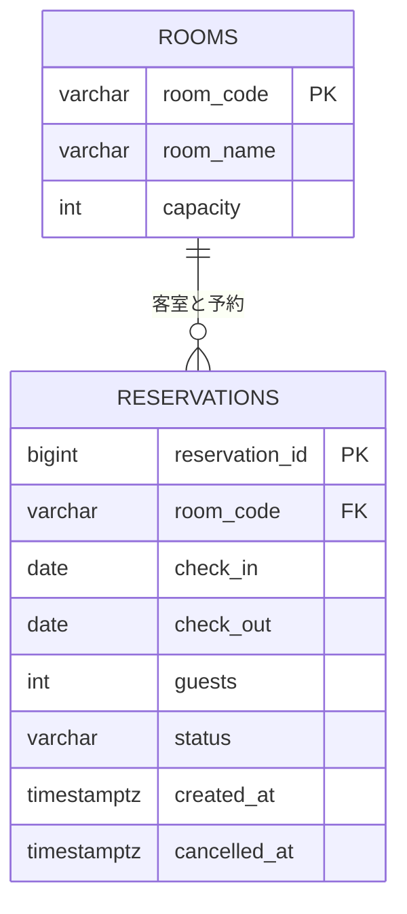

# データベース設計｜夢屋旅館の予約システム

この資料は、予約データをどのように保存し、二重予約を防いでいるかをまとめたものです。実際のSQL定義は [`db/01_schema.sql`](../db/01_schema.sql) にあります。

## データの構成（ER図）



2つのテーブルを使用しています。

| テーブル | 役割 | 主な項目 |
|---|---|---|
| `rooms` | 客室の情報 | 客室コード、客室名、定員 |
| `reservations` | 予約の情報 | 予約ID、客室コード、宿泊日、人数、状態 |

`reservations.room_code` は `rooms.room_code` を参照する外部キーです。存在しない客室の予約を登録できないようにしています。

## 予約登録の流れ

1. 画面で客室・宿泊日・人数を入力する。
2. Java Servletで入力内容を確認する。
3. JDBCからSQLを実行し、PostgreSQLに保存する。
4. 保存した予約IDを画面に表示する。

登録には `PreparedStatement` を使用しています。取消は予約行を消さず、状態を `CANCELLED` に変更します。

## 二重予約をどう防ぐか

同じ客室の宿泊日が重なる予約は、PostgreSQLの**排他制約（`EXCLUDE USING gist`）**で拒否します。Java側の空室確認だけに頼らず、DBに最終的な登録可否を判断させるためです。

- **登録できない例：** 同じ客室で12月15日〜17日と、12月16日〜18日の予約
- **登録できる例：** 同じ客室で12月15日〜17日と、12月17日〜18日の予約（17日は前の予約のチェックアウト日）
- **取消後：** 取消済みの予約と同じ期間に、新しい予約を登録できます。

予約日の大小関係、14泊以内、人数1〜4名などもDBの制約で確認します。

## SQLの例

客室名と予約情報をまとめて表示するためのJOINです。

```sql
SELECT r.reservation_id, m.room_name, r.check_in, r.check_out, r.status
FROM reservations r
JOIN rooms m ON m.room_code = r.room_code
ORDER BY r.created_at DESC;
```

## 確認したことと今後の課題

**確認済み：** ローカル環境で予約登録・検索・重複予約の拒否・取消を実施。独立したテスト用DBで日付の境界、取消後の再予約、ロールバック、DB権限制限、JDBCによる処理を確認しました。クラウドでも予約の保存を確認しています。

**今後の課題：** 複数のSQLを一括で扱う業務処理のトランザクション制御、同時送信への完全な重複登録防止、SQL実行計画を使った性能測定などは、完成済み機能として扱っていません。

詳しい結果と未実施項目は[テスト記録](TEST_PLAN_V2.md)を参照してください。この文書は設計と確認結果の説明であり、すべてのテストが公開環境で実施されたという意味ではありません。
