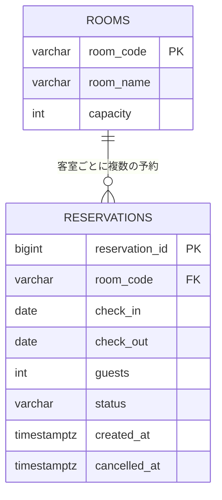

# v2 PostgreSQL / JDBC設計ノート

この資料は、`db/01_schema.sql` とJava実装を基準にした設計説明です。2026-11-15時点で、ローカルPostgreSQL 17への接続とHTTP Smokeを実行済みです。

## ER図（予定ではなくv2ソースに記載した構造）



- **保存:** `ReservationRepository.insert()` が `PreparedStatement` でSQLを実行
- **検索:** `rooms` と `reservations` を `JOIN`。客室・状態を任意に絞り込み
- **取消:** `DELETE` は使わず `UPDATE ... SET status = 'CANCELLED'`
- **二重予約防止:** PostgreSQL `EXCLUDE USING gist` と `daterange(check_in, check_out, '[)')` を利用
- **トランザクション:** 単一INSERT/UPDATEは各SQL文の原子性で完結。複数SQL更新時のトランザクション制御は次段階
- **期間の定義:** チェックアウト日は占有しない。19日〜20日の予約と20日〜21日の予約は重複しない

## テーブル定義と制約

### `rooms`

| 列 | 型 | 制約 | 意図 |
|---|---|---|---|
| `room_code` | `varchar(8)` | PK | 業務上の客室識別子 |
| `room_name` | `varchar(40)` | NOT NULL, UNIQUE | 表示名の重複防止 |
| `capacity` | `integer` | NOT NULL, CHECK 1〜4 | 定員超過の防止 |

### `reservations`

| 列 | 型 | 制約 | 意図 |
|---|---|---|---|
| `reservation_id` | `bigint` | identity, PK | 予約の不変識別子 |
| `room_code` | `varchar(8)` | NOT NULL, FK | 存在する客室だけを予約 |
| `check_in`, `check_out` | `date` | NOT NULL, CHECK | 半開区間の宿泊期間 |
| `guests` | `integer` | NOT NULL, CHECK 1〜4 | 入力値のDB側検証 |
| `status` | `varchar(12)` | NOT NULL, CHECK | `CONFIRMED` / `CANCELLED` |
| `created_at` | `timestamptz` | NOT NULL, DEFAULT | 作成順・監査用 |
| `cancelled_at` | `timestamptz` | 状態整合CHECK | 取消時刻の保持 |

`reservations.room_code`、状態、作成日時に対するインデックスを作成しています。重複防止のGiST排他制約自体も、客室と期間の照合に使われます。

## 制約と注意点

- `room_code` はFK、日時の大小・14泊上限・人数1〜4人・状態整合をCHECK
- `status = 'CONFIRMED'` の予約だけ重複禁止。取消すると別予約の登録が可能
- Javaの入力チェックだけでなくDB制約を置くことで、同時リクエストにも対応する設計
- ローカルのPostgreSQLを使用。個人情報は集めない
- ローカルIP制限は本番の認証・認可の代替ではない

## トランザクションとJava連携

- `ReservationRepository.insert()` は1つのINSERT文（`RETURNING`付き）で登録IDを取得します。
- `ReservationRepository.cancel()` は1つのUPDATE文で状態と取消時刻を同時更新します。
- 各処理はtry-with-resourcesでConnection/Statement/ResultSetを閉じ、SQLExceptionを呼び出し側へ返します。
- PostgreSQLの排他制約違反 `23P01` を `AlreadyBookedException` に変換し、画面には利用者向けの重複メッセージだけを返します。
- 現状は業務処理が単一SQL文で完結するため、明示的な複数文トランザクションは未実装です。将来、決済・在庫・通知を一体化する場合は `setAutoCommit(false)` と明示的なcommit/rollbackを導入します。

### なぜJava側のチェックだけでは不十分か

Java側で「空室検索 → 登録」を分けると、2つのリクエストが同じ空室を同時に確認してから登録する競合が起きます。v2では登録時にPostgreSQLの排他制約を最終防衛線とし、競合した側のSQLSTATE `23P01`をJavaで利用者向けエラーへ変換します。これにより、アプリケーションのタイミングに依存せずDB自身が整合性を保証します。

### 面接で説明できるポイント

1. 期間を半開区間にした理由と、チェックアウト日・次のチェックイン日の境界を説明できる。
2. `EXCLUDE USING gist`を使い、同時予約の競合をDB制約で防ぐ理由を説明できる。
3. `PreparedStatement`、try-with-resources、SQLSTATE変換の役割を説明できる。
4. 取消をDELETEにせず状態遷移として保存することで、履歴と再予約を両立している。
5. 現状は単一SQLの原子性に依存し、複数業務処理の明示的トランザクションや冪等性キーは今後の課題だと区別できる。

## SQL実行例

```sql
-- 客室と予約の一覧
SELECT r.reservation_id, m.room_name, r.check_in, r.check_out, r.status
FROM reservations r
JOIN rooms m ON m.room_code = r.room_code
ORDER BY r.created_at DESC;

-- 確定予約だけの期間検索
SELECT room_code, check_in, check_out
FROM reservations
WHERE status = 'CONFIRMED'
  AND daterange(check_in, check_out, '[)') && daterange(DATE '2026-12-15', DATE '2026-12-17', '[)');
```

`db/02_demo_queries.sql` に確認用JOIN・集計・EXPLAIN例、`db/03_manual_constraint_test.sql` にロールバックを含む重複制約テストを収録しています。これらは今回の監査では追加実行していません。

## 採用担当者に説明する実験

1. 同室・日付が重なる2件を試す→後の登録を拒否する（DB制約）
2. チェックアウトとチェックインが同日の予約は許可する（境界条件）
3. キャンセル後に同日程を再予約できることを確認する（状態制御）
4. 予約件数を増やす前後で `EXPLAIN (ANALYZE, BUFFERS)` を比較する（性能検証）

※この文書はテスト手順です。PostgreSQL上の実動作や性能改善の数値は、実際に試すまで「検証済み」として掲載しないでください。
